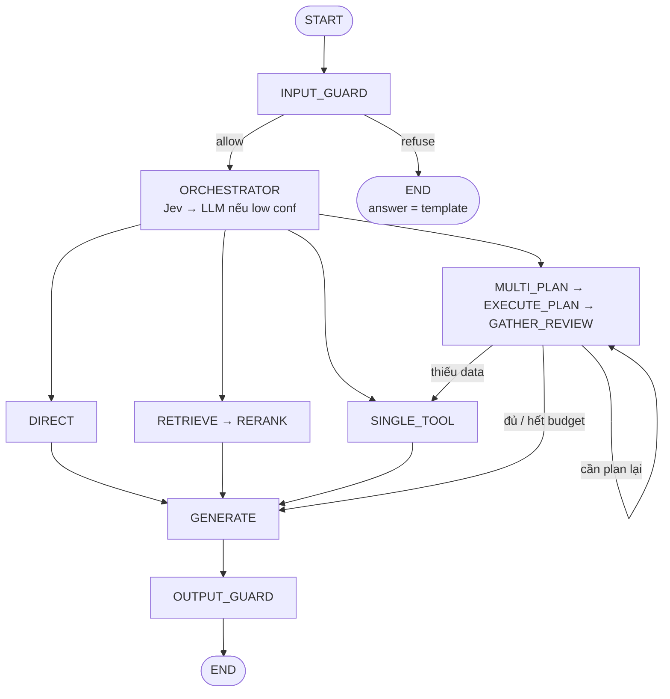

# Kiến trúc Agent (LangGraph)

Tài liệu hub: Input guard → Orchestrator phân luồng → Direct / Retrieve (+ Rerank) / Single tool / Multi-plan → Generate → Output guard. Không dùng vòng ReAct thuần.

Khung dự án tổng: `[../architecture.md](../architecture.md)`.

## Docs trong thư mục này


| File                                                       | Nội dung                                          |
| ---------------------------------------------------------- | ------------------------------------------------- |
| `[agent-architecture.md](./agent-architecture.md)`         | Hub: diagram, nguyên tắc, ví dụ luồng             |
| `[routing-jev.md](./routing-jev.md)`                       | Jev + LLM fallback (orchestrator / gather_review) |
| `[state.md](./state.md)`                                   | AgentState + schema quyết định                    |
| `[nodes.md](./nodes.md)`                                   | Trách nhiệm từng node + edges                     |
| `[plan-execute.md](./plan-execute.md)`                     | multi_plan, `$stepN`, review budget               |
| `[tools.md](./tools.md)`                                   | Registry tools                                    |
| `[generate-and-rag-ports.md](./generate-and-rag-ports.md)` | generate + port retrieve/rerank                   |
| `[guardrails.md](./guardrails.md)`                         | `input_guard` + `output_guard`                    |


## Tổng quan

`agent/` chỉ lo **state, nodes, tools, prompts, routing, compile graph**.

Không xử lý FastAPI request, JWT, upload PDF — thuộc `app/` và `rag/`.

### Cách đọc (4 pha)

1. **Vào** — `INPUT_GUARD` kiểm tra query; refuse → set template từ chối → END.
2. **Chọn đường** — `ORCHESTRATOR` chỉ phân loại (không trả lời user).
3. **Làm việc** — một trong 4 nhánh: trả lời thẳng · RAG · 1 tool · nhiều tool (+ review).
4. **Ra** — nhánh allow hội tụ `GENERATE` → `OUTPUT_GUARD` → END.

Chi tiết guard: `[guardrails.md](./guardrails.md)`.

### Pipeline rút gọn

```text
START → INPUT_GUARD → ORCHESTRATOR → [làm việc] → GENERATE → OUTPUT_GUARD → END
              │ refuse
              └──────────► END  (answer = template từ chối)
```


### Chi tiết nhánh

```text
                          START
                            │
                            ▼
                       INPUT_GUARD
                     allow │    │ refuse → answer=template → END
                           ▼
                      ORCHESTRATOR
               (Jev → LLM nếu low conf)
                           │
           ┌─────────┬─────┼────────┬──────────┐
           ▼         ▼     ▼        ▼          │
        DIRECT   RETRIEVE SINGLE  MULTI_PLAN   │
      (không     (RAG)    TOOL    (lập plan)   │
       làm thêm)   │        │        │         │
           │       ▼        │        ▼         │
           │    RERANK      │  EXECUTE_PLAN    │
           │    → docs[]    │  (chạy lần lượt) │
           │       │        │        │         │
           │       │        │        ▼         │
           │       │        │ GATHER_REVIEW    │
           │       │        │ đủ? → generate   │
           │       │        │ thiếu? → thêm    │
           │       │        │ tool / plan lại  │
           │       │        │ (max loops)      │
           │       └────┬───┘────────┘         │
           │            ▼                      │
           └──────► GENERATE ◄─────────────────┘
                        │
                        ▼
                   OUTPUT_GUARD
                        │
                        ▼
                       END
```




## Nguyên tắc

1. Orchestrator chỉ **phân loại + plan thô** — chi tiết: `[routing-jev.md](./routing-jev.md)`.
2. **Jev** classify `orchestrator` / `gather_review`; confidence thấp → **LLM fallback**. Control flow ở LangGraph.
3. Jev **không** generate, **không** viết `plan[]` / `$stepN` — thuộc `generate` / `multi_plan`.
4. Nhánh allow: câu trả lời qua **GENERATE** rồi **OUTPUT_GUARD** trước END.
5. **INPUT_GUARD** đứng trước orchestrator; **refuse → set template → END** (không generate, không output_guard) — `[guardrails.md](./guardrails.md)`.
6. Multi-tool = plan list cứng — `[plan-execute.md](./plan-execute.md)`.
7. **GATHER_REVIEW** có `max_review_loops`; hết budget → code ép `generate`.
8. RAG: **retrieve → rerank → generate** qua port — `[generate-and-rag-ports.md](./generate-and-rag-ports.md)`.
9. Không lớp ReAct Thought/Action riêng.
10. FastAPI chỉ `graph.invoke` / `ainvoke`.
11. Interface routing (port) để đổi Jev ↔ LLM mà graph không đổi.


## Ví dụ luồng


### A. Trả lời luôn

`Chào bạn` → input_guard → orchestrator `direct` → generate → output_guard → END

### B. Một tool

`Bây giờ là mấy giờ ở TP.HCM?` → input_guard → `single_tool(time_now)` → generate → output_guard → END

### C. RAG

`Trong file PDF tôi upload, mục 3 nói gì?` → input_guard → retrieve → rerank → generate → output_guard → END

### D. Nhiều tool + review

`Tính % thay đổi từ 100 lên 125, rồi giải thích bằng search`

1. input_guard → orchestrator → `multi_plan`
2. plan: calc_percent_change → tavily_search (nếu cần ngữ cảnh)
3. execute_plan
4. gather_review → đủ → generate → output_guard → END


### E. Input bị từ chối

query vi phạm policy → input_guard `refuse` → `answer` = template → END

## Cây file dự kiến (`agent/`)

```text
agent/
├── state.py
├── models.py        # ChatOpenAI factory (OPENAI_*)
├── graph.py
├── nodes/           # xem nodes.md
├── routing/         # xem routing-jev.md
├── guardrails/      # xem guardrails.md
├── tools/           # xem tools.md
└── prompts/
```


## Ranh giới repo


| Lớp        | Việc                                                        |
| ---------- | ----------------------------------------------------------- |
| `app/`     | HTTP, auth, upload, gọi `graph`                             |
| `rag/`     | Ingest, embeddings, vectorstore, rerank impl; node gọi port |
| `agent/`   | Điều phối suy luận + tools + generate                       |
| `workers/` | Job nền — không nằm trong graph chat                        |


## Thứ tự implement gợi ý

1. `state.py` — `[state.md](./state.md)`
2. `routing/` — `[routing-jev.md](./routing-jev.md)`
3. `nodes/orchestrator.py` + prompts
4. `generate` + `retrieve`/`rerank` (stub ok) — `[generate-and-rag-ports.md](./generate-and-rag-ports.md)`
5. `single_tool` + registry — `[tools.md](./tools.md)`
6. `multi_plan` + `execute_plan` — `[plan-execute.md](./plan-execute.md)`
7. `gather_review` + budget
8. `input_guard` + `output_guard` — `[guardrails.md](./guardrails.md)`
9. `graph.py` + nối FastAPI chat
10. (Sau) rerank thật / GraphRAG trong `rag/`

